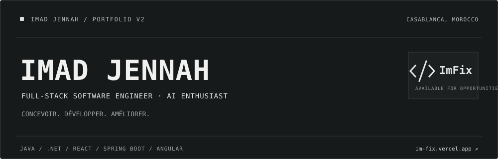

<!-- Profile README · visual language aligned with https://im-fix.vercel.app/ -->

  

## `imad@portfolio:~/profile`

**Software engineer · Full-stack developer · AI enthusiast**  
Casablanca, Morocco · Open to new opportunities

I like turning an idea into a useful application. I have worked on business tools, booking systems, and communication platforms, from understanding the need to developing and deploying the solution. I work across **React, Angular, Spring Boot, and ASP.NET Core**. I also use AI to explore solutions and speed up repetitive work, while taking time to understand and verify the results.

## `./stack`

**Frontend** · React · Angular · Next.js · TypeScript · Tailwind CSS · Ant Design  
**Backend** · Spring Boot · ASP.NET Core · Node.js · Django · REST APIs · JWT  
**Data** · PostgreSQL · MySQL · SQL Server · MongoDB  
**DevOps** · Docker · GitHub Actions · Linux · Nginx · Terraform · Google Cloud

## `./projects --featured`

- **[Meeting Planner](https://github.com/JENNAH-IMAD/Meeting-Planner)** · Meeting-room booking and availability.
- **[TeamTalk](https://github.com/JENNAH-IMAD/Team-Talk)** · Full-stack team communication platform.
- **[IT Equipment Request Manager](https://github.com/JENNAH-IMAD/Application-web-de-gestion-des-demandes-des-equipements)** · IT equipment requests and approval workflow.
- **[Insect Detector](https://github.com/JENNAH-IMAD/Insect-detector)** · Insect classification with machine learning.
- **[Portfolio](https://github.com/JENNAH-IMAD/ImFix)** · The site that inspired this README’s visual theme.

## `./about`

I earned an engineering degree in **Computer Science and Networks**, specializing in **MIAGE**, from EMSI Casablanca. My experience includes full-stack internships at Eurafric Information and Munisys, as well as freelance application development.

## `./contact`

[Portfolio](https://im-fix.vercel.app/) · [LinkedIn](https://www.linkedin.com/in/imad-jennah/) · [Email](mailto:imad.jennah.pro@gmail.com) · [Repositories](https://github.com/JENNAH-IMAD?tab=repositories)
