<!-- Profile README · visual language aligned with https://im-fix.vercel.app/ -->

  <a href="https://im-fix.vercel.app/">
    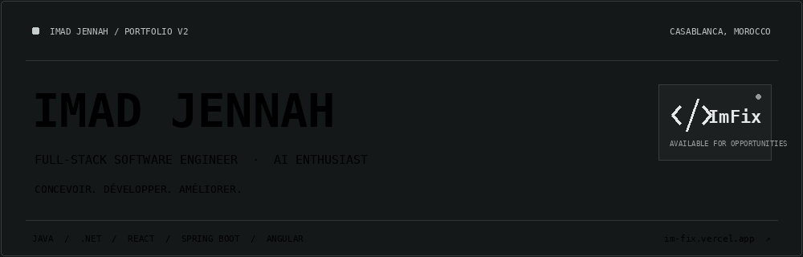
  </a>

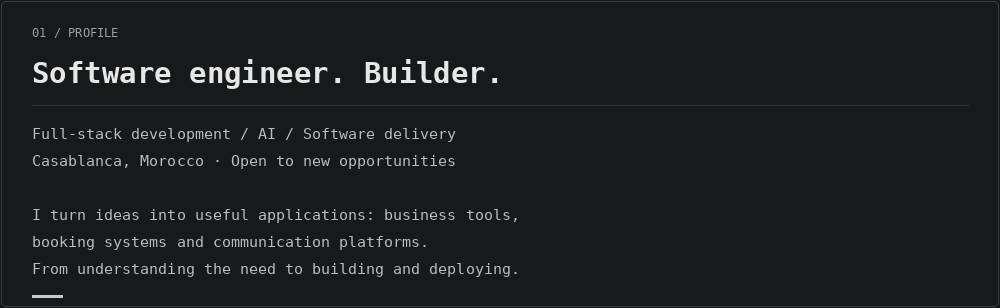

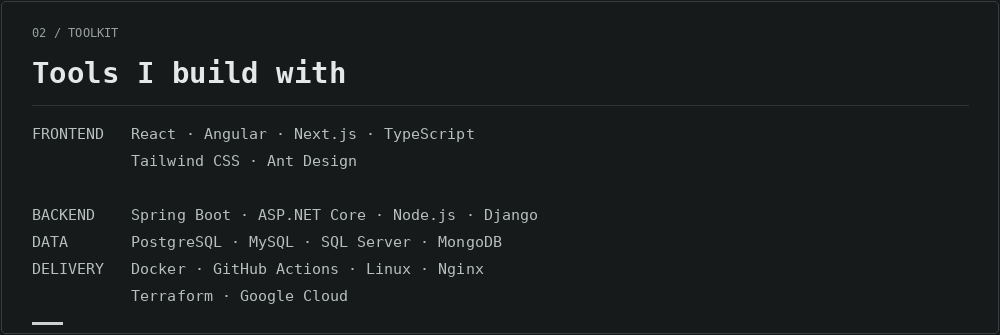

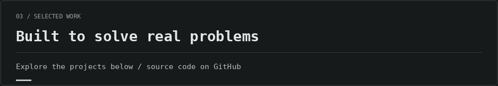

<a href="https://github.com/JENNAH-IMAD/Meeting-Planner">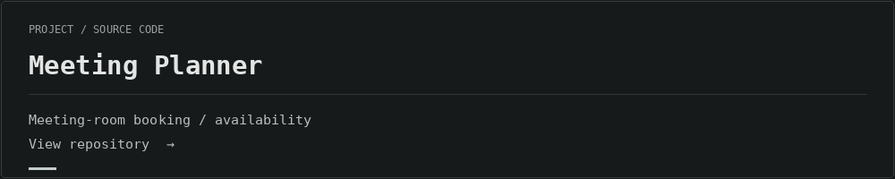</a>

<a href="https://github.com/JENNAH-IMAD/Team-Talk">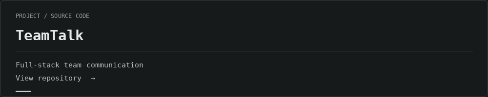</a>

<a href="https://github.com/JENNAH-IMAD/Application-web-de-gestion-des-demandes-des-equipements">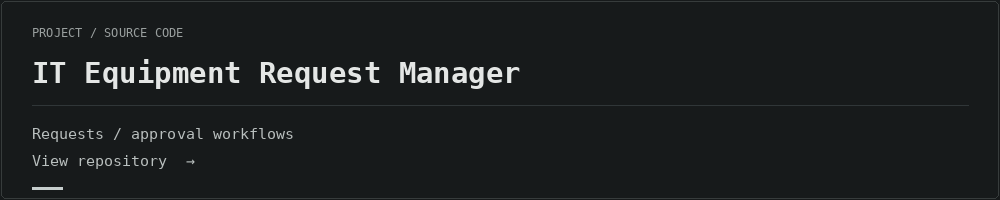</a>

<a href="https://github.com/JENNAH-IMAD/Insect-detector">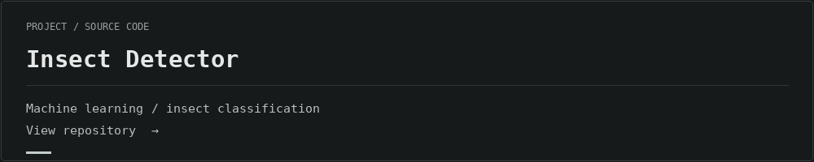</a>

<a href="https://github.com/JENNAH-IMAD/ImFix">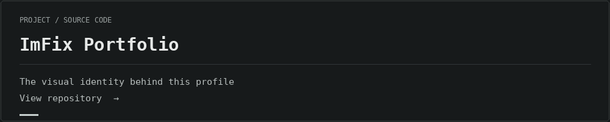</a>

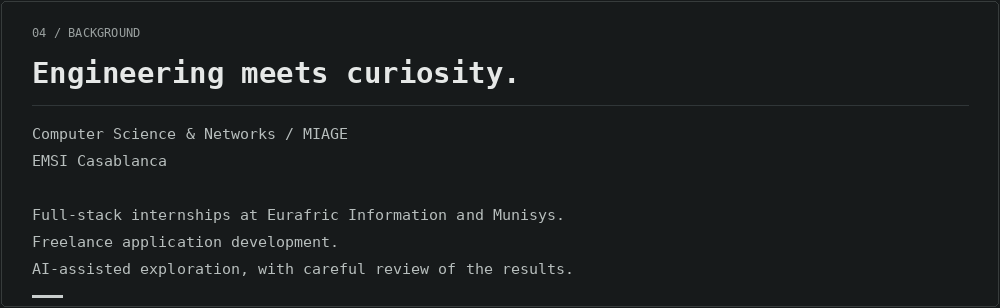

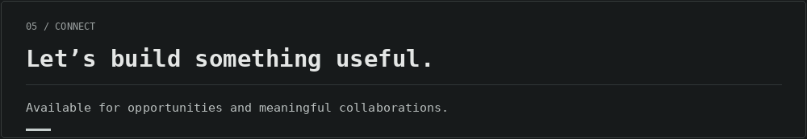

[Portfolio](https://im-fix.vercel.app/) · [LinkedIn](https://www.linkedin.com/in/imad-jennah/) · [Email](mailto:imad.jennah.pro@gmail.com) · [Repositories](https://github.com/JENNAH-IMAD?tab=repositories)
