 

 <a href="https://www.linkedin.com/in/imad-jennah/">LinkedIn</a> &nbsp;/&nbsp; <a href="mailto:imad.jennah.pro@gmail.com">Email</a> &nbsp;/&nbsp; <a href="https://jennah-imad.github.io/Portfolio/">Portfolio</a> &nbsp;/&nbsp; <a href="https://github.com/JENNAH-IMAD">GitHub</a> 

## A little about me

I'm **Imad Jennah**, a computer engineering student (MIAGE) at EMSI in Casablanca, Morocco. I build full stack applications and work on DevOps practices, with a focus on clean, maintainable software and automated delivery.

> "Ship clean code, automate everything."

**Currently exploring:** design systems, CI/CD, cloud-native architecture, AI and open source.

## What I work with

| Frontend | Backend | DevOps & cloud | Data & tools |
|:--|:--|:--|:--|
| React � Angular � Next.js � TypeScript � Tailwind | Spring Boot � Java � .NET � Node.js � Python | Docker � GitHub Actions � Linux � Nginx � GCP � Terraform � Kubernetes | PostgreSQL � MySQL � MongoDB � Redis � SQL Server � Git � Figma |

## Selected projects

## Certifications

Advanced React (Meta) � Java Full Stack (Board Infinity) � Spring Microservices (Google Cloud) � DevOps Foundations (IBM) � UML Modeling (Udemy)

 

**Open to Full Stack and DevOps opportunities** � Full-time � Internship � Freelance � Open Source  
Casablanca, Morocco � Open to remote and international roles

 

