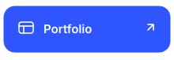
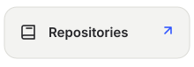

<!-- Three Worlds design adapted from AVIVASHISHTA29/AVIVASHISHTA29. SVGs regenerated daily. -->

 
 
 
 
<picture><source media="(prefers-color-scheme: dark)" srcset="./cards/title-coding-dark.svg" /></picture> 

